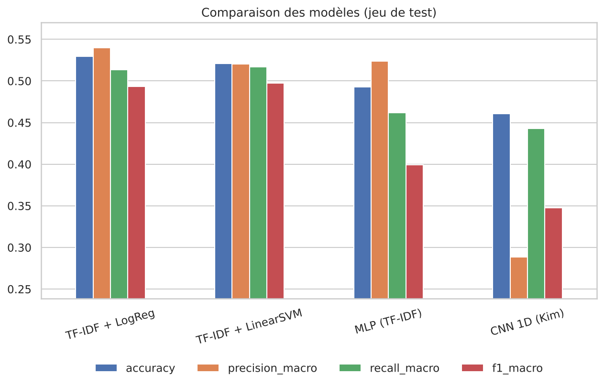
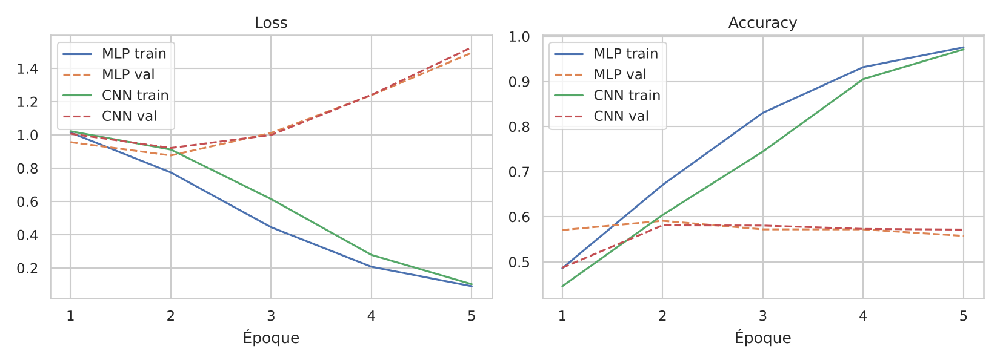

# 💬 Sentiment Lab — Analyse de sentiments multi-modèles

Classification de tweets en **négatif / neutre / positif**, en comparant trois approches avec exactement le même protocole d'évaluation.

[](https://colab.research.google.com/github/MihadB/sentiment-lab/blob/main/notebooks/Sentiment_Lab_Colab.ipynb)

<!-- Ajoute ici une capture d'écran de l'interface :  -->

## 🎯 Objectif

Montrer, chiffres à l'appui, ce qu'apporte chaque niveau de complexité :

| # | Modèle | Représentation du texte | Rôle |
|---|--------|-------------------------|------|
| 1 | TF-IDF + Régression logistique / SVM linéaire | n-grammes pondérés | Baseline à battre |
| 2 | MLP (Dense → Dropout → Softmax) | mêmes vecteurs TF-IDF | Réseau dense |
| 3 | **CNN 1D** type Kim (2014) | embeddings appris | Modèle phare |

Données : [`cardiffnlp/tweet_eval`](https://huggingface.co/datasets/cardiffnlp/tweet_eval) (config `sentiment`, 3 classes) ou votre propre CSV (`text`, `label` avec 0 = négatif, 1 = neutre, 2 = positif).

## 🚀 Démarrage rapide (Google Colab)

1. Cliquez sur le badge **Open In Colab** ci-dessus.
2. **Exécution → Tout exécuter**.
3. L'interface s'affiche dans la dernière cellule : *Données & EDA → Entraînement → Résultats → Démo live*.

> Astuce : activez un GPU (*Exécution → Modifier le type d'exécution*) et mettez le curseur « nombre de textes » à 0 pour entraîner sur tout le dataset.

## 💻 Installation locale

```bash
git clone https://github.com/MihadB/sentiment-lab.git
cd sentiment-lab
python -m venv .venv && source .venv/bin/activate    # Windows : .venv\Scripts\activate
pip install -r requirements.txt

python train_all.py --sample 5000 --epochs 10   # test rapide
python train_all.py                              # entraînement complet
python ui.py                                     # interface Gradio
```

Version Streamlit minimale : `streamlit run app.py` (après entraînement). Docker : `docker build -t sentiment-app . && docker run -p 8501:8501 sentiment-app`.

## 🗂️ Structure

```
├── train_all.py        pipeline complet (EDA → modèles → comparaison)
├── ui.py               interface Gradio à 5 onglets
├── app.py              démo Streamlit minimale
├── notebooks/          notebook Colab tout-en-un
└── src/
    ├── config.py       hyperparamètres et chemins
    ├── data.py         chargement des données
    ├── preprocess.py   nettoyage, lemmatisation, tokenisation, padding
    ├── eda.py          analyse exploratoire
    ├── baseline.py     TF-IDF + LogReg / LinearSVC
    ├── mlp.py          MLP Keras
    ├── cnn.py          CNN 1D (Kim)
    └── evaluate.py     métriques, matrices de confusion, courbes
```

## 🧪 Choix méthodologiques

- **Négations conservées** dans les stopwords (« not good » ≠ « good »).
- **Aucune fuite de données** : vocabulaire, TF-IDF et tokenizer ajustés uniquement sur le train.
- **Early stopping** sur la loss de validation ; note finale sur un jeu de test jamais utilisé pour décider.
- **Métriques macro** (précision, rappel, F1) car les classes sont déséquilibrées.

## 📊 Résultats

Premier run de référence : **5 000 tweets d'entraînement**, 2 000 de validation, 5 000 de test, 10 époques maximum (early stopping).

| Modèle | Accuracy | Précision macro | Rappel macro | F1 macro |
|--------|----------|-----------------|--------------|----------|
| TF-IDF + LogReg | **0.530** | **0.540** | 0.513 | 0.494 |
| TF-IDF + LinearSVM | 0.521 | 0.521 | **0.517** | **0.497** |
| MLP (TF-IDF) | 0.493 | 0.524 | 0.462 | 0.399 |
| CNN 1D (Kim) | 0.461 | 0.289 | 0.443 | 0.348 |




### Analyse

- **La baseline linéaire est la meilleure à ce volume de données.** Les réseaux neuronaux ont besoin de bien plus d'exemples : avec 5 000 tweets, le CNN doit apprendre ~2,5 M de paramètres d'embedding depuis zéro.
- **Surapprentissage net** : la précision d'entraînement atteint ~97 % alors que la validation stagne autour de 57 %, et la loss de validation remonte dès la 2ᵉ époque (courbes ci-dessus). L'early stopping restaure les poids de la meilleure époque.
- **Le neutre absorbe les erreurs** : les matrices de confusion montrent que 52 à 80 % des tweets négatifs sont classés « neutre ». Le CNN ne prédit jamais « négatif » (rappel = 0, d'où la précision macro très basse).
- **Accuracy trompeuse** : répondre toujours « neutre » donne déjà 48 % sur ce test (2 403 neutres sur 5 000). Le F1 macro est donc l'indicateur pertinent.
- **Hypothèse à vérifier** : la répartition des classes diffère entre entraînement et test (graphique de l'onglet *Données & EDA*), ce qui pénaliserait surtout la classe négative.

### Prochaines étapes

Entraînement sur le dataset complet, pondération des classes, embeddings pré-entraînés (GloVe), puis comparaison sur plusieurs graines. Les résultats seront ajoutés ici.

## 🔭 Pistes d'amélioration

- Embeddings pré-entraînés (GloVe / Word2Vec) via `build_kim_cnn(embedding_matrix=...)`
- Pondération des classes, optimisation des hyperparamètres, plusieurs graines
- Fine-tuning d'un transformer (DistilBERT / BERTweet) comme point de comparaison
- API FastAPI + CI GitHub Actions

## 🛠️ Stack

Python · TensorFlow/Keras · scikit-learn · NLTK · pandas · matplotlib/seaborn · Gradio
